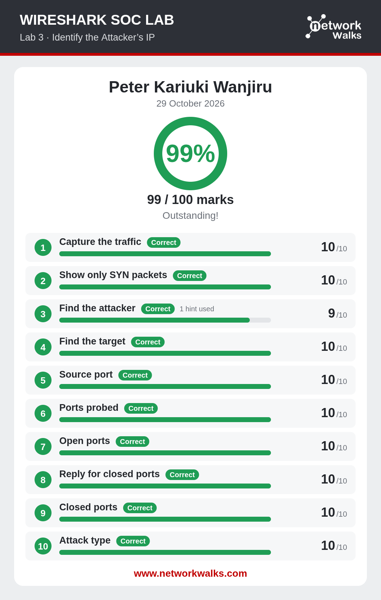
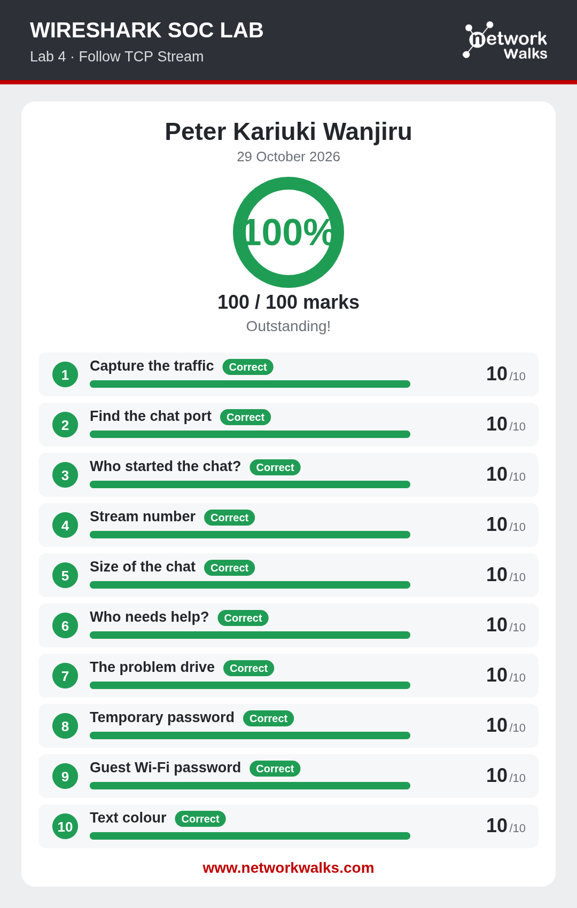
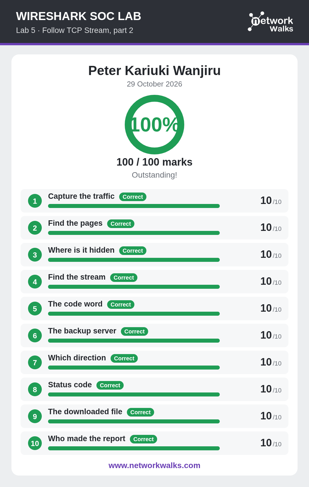
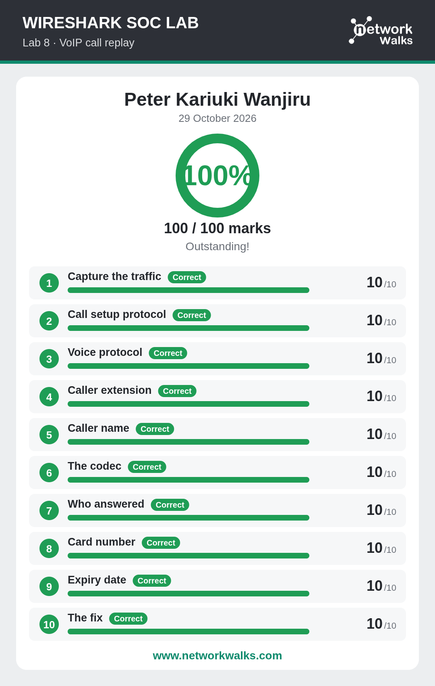

# 🛡️ Wireshark SOC Labs — Completed Portfolio

**Author:** Peter Kariuki Wanjiru  
**Completed:** 29 October 2026  
**Platform:** [NetworkWalks](https://networkwalks.com/wireshark/)

## 📋 Overview

This repository contains my completed work for the **6 Wireshark SOC Labs** from the NetworkWalks Wireshark Project Module. Each lab simulates a real-world SOC analyst scenario requiring packet analysis skills in Wireshark.

## 🏆 Results Summary

| # | Lab | Topic | Score | Status |
|---|-----|-------|-------|--------|
| 1 | Lab 3 | Identify the Attacker's IP | 99/100 | ✅ Passed |
| 2 | Lab 4 | Follow TCP Stream | 100/100 | ✅ Passed |
| 3 | Lab 5 | Follow TCP Stream, Part 2 | 100/100 | ✅ Passed |
| 4 | Lab 6 | HTTP Plain Text Credentials | 100/100 | ✅ Passed |
| 5 | Lab 7 | Catch the Brute Force Attacker | 100/100 | ✅ Passed |
| 6 | Lab 8 | Catch the Call Scammer | 100/100 | ✅ Passed |

**Average Score: 99.83%**

## 🎯 Skills Demonstrated

- **Finding an attacker** — Identifying malicious source IPs from traffic
- **Follow TCP Stream** — Reconstructing and reading conversations
- **Hidden data** — Extracting covert information from streams
- **Clear text passwords** — Finding credentials transmitted over HTTP
- **Brute force detection** — Spotting repeated authentication attempts
- **VoIP calls** — Replaying and analyzing SIP/RTP calls

## 📸 Screenshots

### Lab 3 — Identify the Attacker's IP (99/100)

### Lab 4 — Follow TCP Stream (100/100)

### Lab 5 — Follow TCP Stream, Part 2 (100/100)

### Lab 6 — HTTP Plain Text Credentials (100/100)

### Lab 7 — Catch the Brute Force Attacker (100/100)

### Lab 8 — Catch the Call Scammer (100/100)

## 🛠️ Tools Used

- **Wireshark** — Primary packet analysis tool
- **RTP Player** — VoIP call replay (Lab 8)
- **Follow TCP Stream** — Stream reconstruction
- **Display Filters** — `tcp.flags.syn==1`, `http`, `sip`, `rtp`, etc.

## ⚠️ Disclaimer

All analysis was performed **inside authorized lab environments** provided by NetworkWalks. No real networks or third-party systems were tested or captured. This repository is for educational and portfolio purposes only.

## 📬 Contact

- **GitHub:** [@s4ntrx](https://github.com/s4ntrx)
- **Submission:** [NetworkWalks Submission Page](https://networkwalks.com/submission/)

---

*Completed as part of the SOC Analyst Internship — Wireshark Project Module (Extra).*
