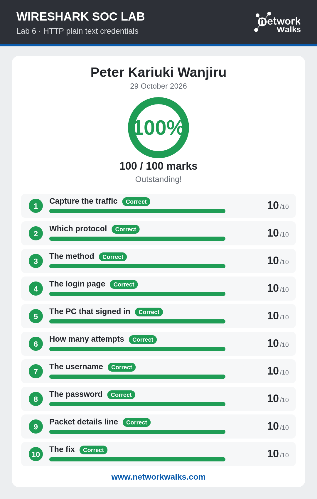

# Lab 6 — HTTP Plain Text Credentials

**Score:** 100/100  
**Date Completed:** 29 October 2026  
**Reference:** [networkwalks.com/wireshark-lab6/](https://networkwalks.com/wireshark-lab6/)

## 🎯 Objective
Find usernames and passwords sent in clear text over HTTP and recommend a fix.

## 🧠 Skills Practiced
- Filtering HTTP POST requests
- Reading form data in packet details
- Identifying login pages and attempts
- Extracting credentials from clear-text traffic
- Recommending HTTPS as remediation

## 📝 Tasks Completed
1. ✅ Capture the traffic
2. ✅ Which protocol
3. ✅ The method
4. ✅ The login page
5. ✅ The PC that signed in
6. ✅ How many attempts
7. ✅ The username
8. ✅ The password
9. ✅ Packet details line
10. ✅ The fix

## 📸 Screenshot

## 🔍 Key Findings
An HTTP POST request to a login page exposed a **username** and **password** in plain text within the packet payload. The recommended fix is to enforce **HTTPS/TLS** for all authentication traffic.
