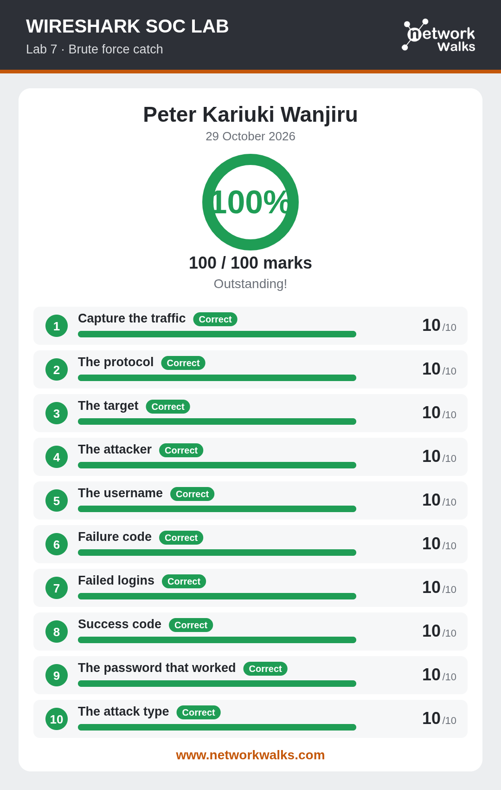

# Lab 7 — Catch the Brute Force Attacker

**Score:** 100/100  
**Date Completed:** 29 October 2026  
**Reference:** [networkwalks.com/wireshark-lab7/](https://networkwalks.com/wireshark-lab7/)

## 🎯 Objective
Spot repeated login attempts and identify the brute force attacker and the password that eventually worked.

## 🧠 Skills Practiced
- Identifying repeated authentication attempts
- Reading failure and success response codes
- Correlating attacker IP with target service
- Extracting the successful password

## 📝 Tasks Completed
1. ✅ Capture the traffic
2. ✅ The protocol
3. ✅ The target
4. ✅ The attacker
5. ✅ The username
6. ✅ Failure code
7. ✅ Failed logins
8. ✅ Success code
9. ✅ The password that worked
10. ✅ The attack type

## 📸 Screenshot

## 🔍 Key Findings
The capture showed **many failed login attempts** from a single attacker IP followed by a **successful login**, indicating a **brute force attack**. The successful password was extracted from the packet where the response code changed from failure to success.
